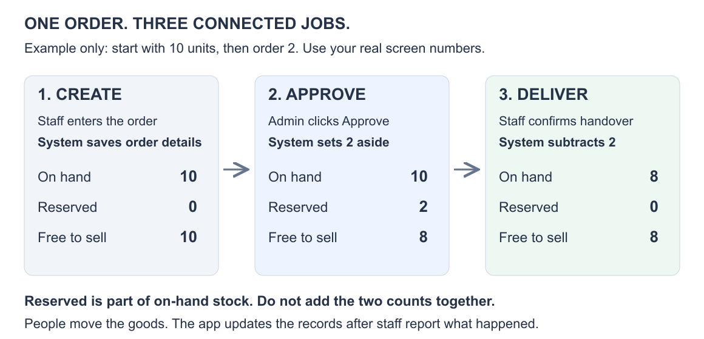
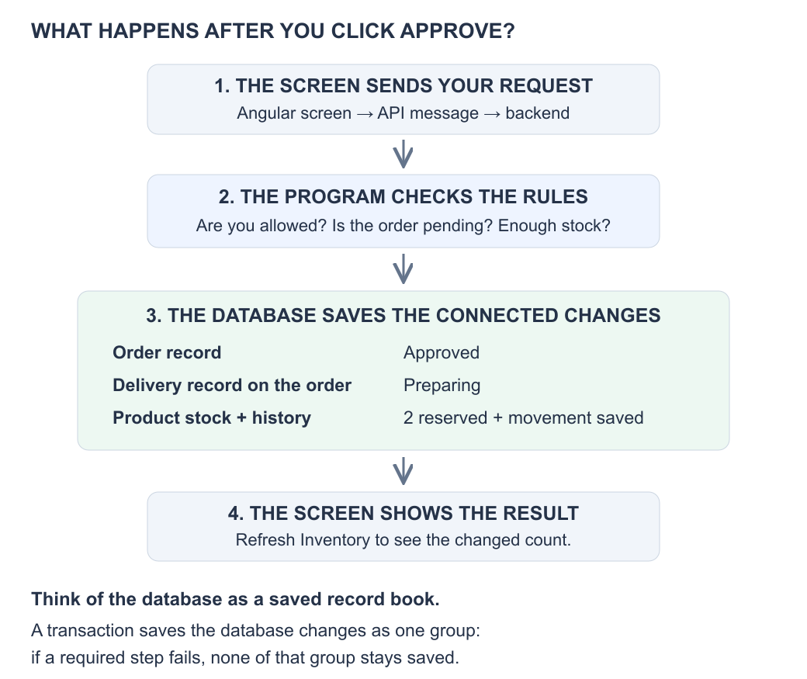
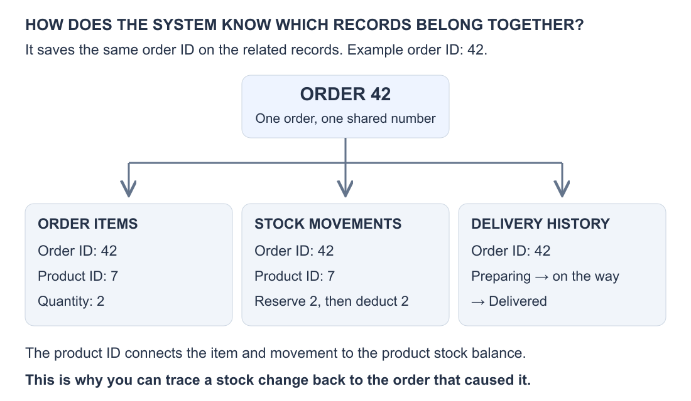

# Objective 2: a simple 10-minute presentation

**Exact objective:** “To automate workflows — order management, deliveries, and inventory.”

**One sentence to remember:** “We enter the order once. When we approve it, the system sets stock aside. When we confirm delivery, the system subtracts that stock and saves what happened.”

Read **Say** aloud. Follow **Click / show** in the system. **What should happen** tells you what to look for. The ten minutes include clicking and waiting. The help sections after the script are for practice and panel questions.

## Understand the story first

Imagine a shop with **10 computer mice**. A customer wants **2**.

1. **Create the order:** write down what the customer wants. No stock is set aside yet.
2. **Approve the order:** promise 2 mice to this customer. They are still in the stock count, but other customers cannot claim them.
3. **Confirm delivery:** record that the customer received the goods. The system removes those 2 from the stock count and clears their reservation.

The app does the record keeping. **People still approve orders, pack goods, and make deliveries.**



These numbers are an example. During the demo, use the numbers actually shown in your system.

| Word on the screen | What it means |
|---|---|
| **On hand** | How many units are recorded in stock. |
| **Reserved** | How many of those units are promised to approved orders. |
| **Available** | How many are still free to sell: on hand minus reserved. |

Reserved stock is already included in on hand. **Do not add the two numbers together.**

## Get ready before presenting

1. Sign in as **Admin** in the demo system using your prepared demo account. See [demo account setup][demo-data] if needed.
2. Open **Orders** and **Inventory** in separate browser tabs.
3. Choose one product with at least **2 available units**. Write down its name, SKU (product code), on-hand count, and reserved count.
4. Pick an existing sample customer. Use a sample Bicol address: `Demo address, Naga City, Camarines Sur`.
5. Keep this guide and the [approval code][approval] ready in your editor.

Use a new order during the presentation. Choose **Office order — no agent**, **Cash on delivery**, and quantity **2**. Leave the delivery employee **Unassigned**; the admin can demonstrate this flow without switching accounts.

For this sample order, we will record an **admin exception** explaining why there is no delivery photo. A delivery employee normally needs a recipient name and photo. Every practice order you complete will reduce the stock count, so check the stock before each rehearsal.

## The 10-minute script

### 0:00–0:45 — Tell the panel your goal

**Click / show:** Open Orders. Point to Orders and Inventory in the menu.

**Say:**

> Good day. Our second objective is: “To automate workflows — order management, deliveries, and inventory.”
>
> In simple terms, we want these parts to work together. Staff enter an order once. The system then handles the related stock counts, delivery records, and history.
>
> I will show one sample order from start to finish.

### 0:45–1:30 — Explain what happens after a click

**Click / show:** Show this diagram in your notes or slide.



**Say:**

> Think of the screen as a shop counter, the backend as the part that checks the rules, and the database as our saved record book.
>
> When I click a button, the screen sends a request. The backend checks it, the database saves the changes, and the screen shows the result.
>
> This is how the different parts work together.

### 1:30–2:00 — Show the stock before the order

**Click / show:** Open Inventory. Find your chosen product. Point to **on hand** and **reserved**.

**Say:**

> This is the product we will use. On hand means the stock we have recorded. Reserved means stock already promised to approved orders.
>
> Please note these starting numbers. We will order two units and compare the counts afterwards.

**What should happen:** Nothing changes yet. You are only looking at the stock.

### 2:00–3:15 — Show a missing-input error, then create the order

**Click / show:**

1. Go to **Orders → New order**.
2. Click **Create order** with the form empty. Point to the missing-field feedback.
3. Select your sample customer. Leave **Assigned agent (optional)** as **Office order — no agent**.
4. Click **Add item**, select the product, enter quantity **2**, then **Add to order**.
5. Enter the sample address and choose **Cash on delivery**. Point to the calculated total.
6. Click **Create order**. When the list returns, open the new order.

**Say:**

> First, I will try to submit an empty form. The system asks for the missing details instead of saving an incomplete order.
>
> Now I will select a customer, two units, and a delivery address. The system calculates the total and gives the order a tracking number.
>
> The order is Pending, meaning it is waiting for approval. Stock is checked, but nothing is reserved yet.

**What should happen:** A new **Pending** order appears. Note its tracking number so you can find the same order again.

### 3:15–4:15 — Approve the order and show what changes

**Click / show:**

1. Click **Approve** on the new order. Confirm if asked and wait for success.
2. Point to **Approved** and delivery **Preparing**.
3. Switch to Inventory and refresh the page. Find the same product.

**Say:**

> The administrator decides whether to approve the order.
>
> After approval, the system automatically sets two units aside and marks the delivery as Preparing.
>
> Here, reserved stock has increased by two, but on hand is unchanged. One approval has updated orders, delivery, and inventory together.

**What should happen:** Reserved increases by **2**. On hand stays the same. You do not use **Adjust stock**.

### 4:15–5:30 — Prepare and show the delivery stages

**Click / show:** Return to the same order.

1. Under **Delivery region and SLA**, choose **Bicol · 1–3 business days** and remote-area allowance **None**.
2. Click **Save delivery policy**, then **Mark prepared**.
3. Click **Mark dispatched**. Point to the calculated delivery dates.
4. Click **Mark in transit**, then **Mark out for delivery**. Wait after each click.

**Say:**

> We choose the delivery area and confirm that the order is ready. When it is dispatched, the system calculates its delivery window using the saved regional rules.
>
> Staff update these stages as the delivery happens. The app saves their updates; it does not detect the truck by itself.
>
> I am moving through the stages quickly because this is a demonstration.

**What should happen:** The delivery stage changes. Stock remains reserved. You do not need to enter a separate arrival estimate for this flow.

### 5:30–6:30 — Confirm the sample delivery

**Click / show:**

1. Click **Record delivery completion**.
2. Enter `Demo Recipient` in **Received by**.
3. Leave **Proof photo** empty. In **Reason for completing without a photo**, enter:

   `Panel demonstration using sample data; no physical handover.`

4. Click **Confirm delivered**. Wait for success.
5. Show the saved recipient and admin exception. Use **View proof of delivery** if needed.

**Say:**

> We must record who received the goods. Delivery employees also need a photo.
>
> As admin, I can record an explanation when there is no photo. Here, I clearly state that this is a sample demonstration, with no real handover.
>
> When I confirm, the system saves the delivery record and updates the stock.

**What should happen:** Delivery becomes **Delivered**. The recipient and explanation are saved.

### 6:30–7:30 — Show the final stock and saved history

**Click / show:**

1. Refresh Inventory. Find the same product.
2. Compare the counts with your starting numbers.
3. Return to the order and point to its history and payment status.

**Say:**

> The on-hand count is now two lower. The two units reserved for this order have also been cleared. Other orders may still have their own reservations.
>
> I did not update inventory by hand. Confirming delivery caused the system to update it.
>
> The history shows what happened. Payment is still Unpaid because receiving goods and receiving payment are separate things.

**What should happen:** On hand is **2 lower than the starting count**. Reserved returns to its starting count if nobody else changed stock during the demo.

### 7:30–9:15 — Show the code and explain it simply

**Click / show:** Have these three files ready. Show a small section at a time.

| Show this code | Point to | Say this |
|---|---|---|
| [Approval code][approval] | `stock_reserved=stock_reserved+?`, then `APPROVED` / `PREPARING` just below | “This is the instruction that sets stock aside. The same approval also updates the order and delivery.” |
| [Delivery code, line 260][deduction-line] | `stock_on_hand=stock_on_hand-?` and `stock_reserved=stock_reserved-?` | “These instructions subtract the delivered goods and clear their reservation.” |
| [Database table][movement-schema] | `product_id`, `quantity`, and `order_id` | “This defines how each stock change is saved. The internal order ID connects the change to its order.” |

**Then say:**

> We used Angular for the screens, Express on Node.js for the backend, and MySQL for the database.
>
> One challenge is stopping two orders from claiming the same stock. The system checks stock and makes competing updates wait their turn.
>
> Another challenge is avoiding half-saved changes. The related database updates are saved as one group. If a required step fails, the group is undone.
>
> Confirming the same delivery again also does not subtract the goods twice.

**Practice help:** The next section explains the actual code piece by piece. You do not need to explain every symbol during the presentation.

### 9:15–10:00 — Finish with input, work, and result

**Click / show:** Return to the delivered order.

**Say:**

> Our input was the customer, product, quantity, address, and payment method.
>
> The system's work was checking the details, calculating the total, setting stock aside, and updating it after delivery.
>
> The result was a saved order, tracking number, updated stock, and delivery history.
>
> This meets Objective 2 because orders, deliveries, and inventory work together without entering the same information again. Thank you.

## Code help: read this slowly before practicing

You are explaining **what the instructions do**. You do not have to pretend to know every programming detail.

### 1. How a button reaches the backend

Think: **“Send the filled-out order form to the part that checks and saves it.”**

Open [the browser's order request, line 478][api-client]. Inside `createOrder`, you will see:

```ts
`${this.baseUrl}/orders`,
input,
```

| Code | Simple meaning |
|---|---|
| `this.http.post` just above these lines | Send information to the backend. |
| `/orders` | The address for handling orders inside the API. |
| `input` | The customer, items, quantities, address, and payment method being sent. |

**API** means the agreed way the screen and backend exchange requests and answers. See the “inside one click” diagram above.

**Tell the panel:** “This sends the form details to the backend, where they are checked and saved.”

### 2. How the system refuses a bad quantity

Open [the quantity rule, line 2][quantity-rule]:

```ts
const quantity = z.number().int().positive().max(10000);
```

Read it as: **“Quantity must be a number, a whole number, greater than zero, and no more than 10,000.”**

The `z` comes from **Zod**, a tool the backend uses to check incoming values.

| Example | Allowed? |
|---|---|
| `2` | Yes, subject to enough stock. |
| `0`, `-2`, or `1.5` | No. |

This is one server-side rule, not the entire form validation. The form also helps the user catch missing information before sending it.

**Tell the panel:** “We check inputs on the screen and again in the backend. The quantity rule prevents invalid amounts.”

### 3. How it knows whether enough stock is left

Open [the stock check, line 65][stock-check]. The key expression is:

```ts
p.stock_on_hand - p.stock_reserved < i.quantity
```

| Part | Simple meaning |
|---|---|
| `p.stock_on_hand` | This product's stock count. |
| `p.stock_reserved` | How many are already promised. |
| `i.quantity` | How many this order needs. |
| `-` | Subtract. |
| `<` | Is the amount on the left smaller than the amount on the right? |

Example: **10 in stock − 2 already promised = 8 free.** If another order asks for 9, the system refuses it because 8 is less than 9.

**Tell the panel:** “The system checks what is free to sell, not just what is in stock.”

### 4. How approval changes three things together

Open [the approval handler, line 404][approval]. Search for `stock_reserved=stock_reserved+?`.

These are the SQL instructions inside that TypeScript file:

```sql
UPDATE products SET stock_reserved=stock_reserved+? WHERE id=?
```

| Part | Simple meaning |
|---|---|
| `UPDATE products` | Change a product's saved record. |
| `stock_reserved=stock_reserved+?` | Add this order's quantity to the reserved count. |
| `WHERE id=?` | Change only the selected product. |

Below it, the code saves the stock movement and updates the order with:

```sql
order_status='APPROVED',delivery_status='PREPARING'
```

**That is the connection:** order approved → stock reserved → delivery preparing. The arrows in the “inside one click” diagram show these linked updates.

The `?` symbols are spaces where the backend supplies real values. For our product, it passes quantity **2** and that product's ID. They are not missing code.

**Tell the panel:** “This is why approving an order also updates delivery and inventory.”

### 5. How delivery changes the stock count

Open [the deduction, line 260][deduction-line]:

```sql
UPDATE products SET stock_on_hand=stock_on_hand-?,stock_reserved=stock_reserved-? WHERE id=?
```

Read it in two small pieces:

| Piece | Simple meaning for our order |
|---|---|
| `stock_on_hand=stock_on_hand-?` | Subtract 2 from the recorded stock. |
| `stock_reserved=stock_reserved-?` | Clear the 2 units promised to this order. |

Below this, an `INSERT INTO inventory_movements` instruction saves a new history entry marked `DEDUCT`.

**Tell the panel:** “Once delivery is confirmed, these instructions update the stock and record which order caused the deduction.”

### 6. How it avoids half-saved changes

Open [the transaction helper, line 4][transaction]. These lines appear inside its success and error-handling sections:

```ts
await connection.beginTransaction();
const result = await work(connection);
await connection.commit();
```

If an error happens, the error-handling section calls:

```ts
await connection.rollback();
```

| Code | Simple meaning |
|---|---|
| `beginTransaction()` | Start a group of connected database changes. |
| `work(connection)` | Carry out the changes in that group. |
| `commit()` | Save the whole group successfully. |
| `rollback()` | Undo the group's database changes if something fails. |

**Tell the panel:** “The connected changes succeed together. We avoid saving an approved order while leaving its required stock update unfinished.”

For competing approvals, [the stock check][stock-check] uses `FOR UPDATE` when requested. Think of this as **“wait your turn before changing this product.”** For repeated delivery updates, [the delivery guard][delivery-guard] returns without deducting again when the stage is already the same.

### 7. How the database connects the records

Think of a database table as a saved spreadsheet. An **ID** is the internal number that identifies a record. It is different from the customer-facing tracking number.



Open [the stock movement table, line 120][movement-schema]. Look at:

```sql
product_id BIGINT UNSIGNED NOT NULL,
quantity INT UNSIGNED NOT NULL,
order_id BIGINT UNSIGNED NULL,
```

| Field | Question it answers |
|---|---|
| `product_id` | Which product changed? |
| `quantity` | How many units? |
| `order_id` | Which order caused this movement? |
| `type` elsewhere in the same table | Was this a reservation, deduction, or another stock movement? |

Some manual stock movements have no order. For our demonstration, the reservation and deduction both link to the same order.

The other words describe the kind of value the field stores: **`INT` / `BIGINT`** mean whole numbers (`BIGINT` can hold larger ones); **`UNSIGNED`** means no negative numbers; **`NOT NULL`** means a value is required; **`NULL`** means it may be empty.

**Tell the panel:** “The shared order ID lets us connect an order, its delivery history, and its stock changes.”

The SQL files show **how records are organized**. To see **actual saved rows**, use a database viewer already connected to the demo database, with the queries below. Do not try to configure that viewer during the presentation.

## Where to open the files

Share the repository with its folders intact. Keep this Markdown file in `docs/` and the three images in `docs/objective-2-diagrams/`. All links are relative, so they work from a colleague's copy.

In VS Code:

1. Choose **File → Open Folder** and open the folder containing `backend/`, `frontend/`, and `docs/`.
2. Press **Ctrl+P** and paste `backend/src/features/orders/route.ts`.
3. Press Enter. Then press **Ctrl+G**, type `404`, and press Enter.
4. If the line has moved, press **Ctrl+F** and search for `"/:id/decision"`.

Links use GitHub-style line numbers such as `#L404`. A local viewer may open the file without jumping to the line; **Ctrl+G** is the fallback.

| If asked about… | Open this file |
|---|---|
| The order form | [frontend/src/app/features/orders/new-order.page.ts, line 278][create-ui] |
| Sending the order | [frontend/src/app/core/api.service.ts, line 478][api-client] |
| Checking quantity | [backend/src/features/orders/validation.ts, line 2][quantity-rule] |
| Checking stock | [backend/src/features/orders/sales.ts, line 65][stock-check] |
| Approving and reserving | [backend/src/features/orders/route.ts, line 404][approval] |
| Completing and deducting | [backend/src/features/delivery/service.ts, line 260][deduction-line] |
| Saving a group of changes | [backend/src/shared/transaction.ts, line 4][transaction] |
| Stock table | [backend/src/database/schema.sql, line 47][stock-schema] |
| Stock movement table | [backend/src/database/schema.sql, line 120][movement-schema] |
| Delivery proof table | [backend/src/database/delivery-schema.sql, line 44][proof-schema] |

## Questions the panel may ask

**“What does automate mean here?”**

“A staff action starts the process. The system then performs the connected record updates, so staff do not have to enter them separately.”

**“What is integration?”**

“The parts work together. Approving this order changes delivery and stock too.”

**“Does the system know the goods arrived by itself?”**

“Staff confirm what happened. The app checks and saves their update.”

**“Does Delivered mean Paid?”**

“No. Delivered means the goods were received. Paid means full payment was recorded. A financially completed sale requires both.” See [the payment-and-delivery check][financial-completion]. The existing `COMPLETED` order status represents delivery completion.

**“What if two orders want the same last item?”**

“The system checks and updates stock in a controlled order. A competing approval waits and then checks the updated count.”

**“What if someone confirms the same delivery twice?”**

“The system recognizes that it is already delivered and does not subtract the stock again.”

**“Why is there no delivery photo in this demo?”**

“This is a sample order. The admin records a visible explanation. A delivery employee must provide a photo.”

**“Are reminders automatic too?”**

“Optional reminders run through a separate background worker and must be enabled. The stock changes shown here work without enabling those reminders.” See [the worker][worker] and [demo setup][demo-data].

**“Does low stock automatically buy more products?”**

“No. The system gives stock information and optional alerts. Staff decide when to buy more.”

## Optional: show actual database rows

Use only if someone has already prepared the database viewer. Replace the sample placeholders with the actual product code and tracking number from your demonstration. These queries only read records.

**Show the product counts:**

```sql
SELECT sku, name, stock_on_hand, stock_reserved,
       stock_on_hand - stock_reserved AS available
FROM products
WHERE sku = 'PASTE_PRODUCT_SKU_HERE';
```

**Show the order and the stock changes it caused:**

```sql
SELECT id, tracking_number, order_status, delivery_status, payment_status
FROM orders
WHERE tracking_number = 'PASTE_TRACKING_NUMBER_HERE';

SELECT m.order_id, p.sku, m.type, m.quantity, m.created_at
FROM inventory_movements AS m
JOIN orders AS o ON o.id = m.order_id
JOIN products AS p ON p.id = m.product_id
WHERE o.tracking_number = 'PASTE_TRACKING_NUMBER_HERE'
ORDER BY m.id;
```

For this order, expect one movement marked **RESERVE, quantity 2** and another marked **DEDUCT, quantity 2**.

## If something goes wrong

| Problem | What to do |
|---|---|
| Cannot dispatch | Click **Save delivery policy**, then **Mark prepared**. |
| Stock numbers look unchanged | Refresh Inventory and check the same product code. |
| Completion will not save | Fill **Received by** and the reason for no photo. Wait for earlier actions to finish. |
| The screen reports a conflict | Reload the order, then continue. |
| Not enough stock | Pick a product with at least two available units before starting. |

## Quick rehearsal check

- Can you explain “reserved” as **promised, but still included in stock**?
- Can you show the same product before approval, after approval, and after delivery?
- Can you point to the **plus** in the approval code and the two **minus** signs in the delivery code?
- Can you explain the database as a **saved record book**, linked by the same order ID?
- Can you finish with a timer? The diagrams and code help are practice material; only the timed section is your ten-minute talk.

This covers the panel's ten requirements: exact objective; feature developed; system integration; communication between parts; database/data flow; sample demonstration; input/work/result; validation/errors; technologies; and technical challenges addressed by the implementation. Describe a challenge as a personal development experience only if that is accurate.

Checked against the source code and screen templates. Live clicks, current stock, and actual presentation timing still need rehearsal.

[demo-data]: DEMO_DATA.md
[api-client]: ../frontend/src/app/core/api.service.ts#L478
[create-ui]: ../frontend/src/app/features/orders/new-order.page.ts#L278
[quantity-rule]: ../backend/src/features/orders/validation.ts#L2
[stock-check]: ../backend/src/features/orders/sales.ts#L65
[approval]: ../backend/src/features/orders/route.ts#L404
[deduction-line]: ../backend/src/features/delivery/service.ts#L260
[transaction]: ../backend/src/shared/transaction.ts#L4
[delivery-guard]: ../backend/src/features/delivery/service.ts#L168
[stock-schema]: ../backend/src/database/schema.sql#L47
[movement-schema]: ../backend/src/database/schema.sql#L120
[proof-schema]: ../backend/src/database/delivery-schema.sql#L44
[financial-completion]: ../backend/src/features/orders/sales.ts#L293
[worker]: ../backend/src/features/automations/worker.ts#L229
